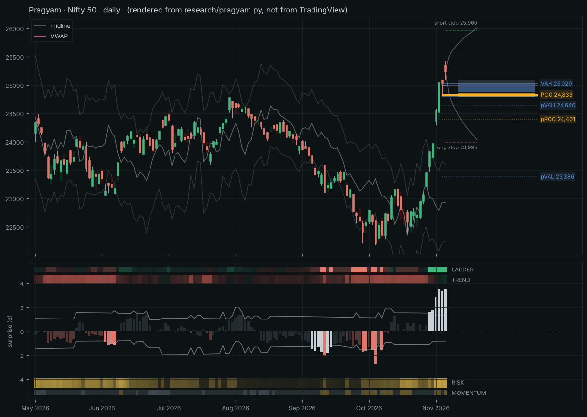

# Indicator

| File | What it is |
|---|---|
| `pragyam.pine` | **Pragyam** — one self-contained TradingView indicator (Pine v6): calibrated risk, exposure, tapes, self-audit and volume profile. |
| `pragati.pine` | **Pragati** — the original multi-timeframe conviction oscillator. Unchanged; it was the direction of thought and the benchmark. |
| `research/` | The data fetch, the Python reference for Pragyam, and the study behind every number below. |

## Pragyam

*Pragyam*, from *prajñā*, discernment: telling what can be known from what cannot. (Developed as Kasauti through v2.3.)
It is **one script**. The pane, the tapes, the cone and stops, the volume profile and the table are all the same indicator.
The only data it requests is the chart symbol's own lower timeframe, for the profile.

It answers three questions for the chart it is on, and then tests its own answers:

1. **How far can it go?** A cone for the close 10 bars ahead that holds 80% of the time.
2. **Where am I wrong?** A stop level that is touched within 10 bars 20% of the time, and the position size that goes with it.
3. **How much should I hold?** An exposure dial between 0 and 1.



*Rendered from the reference implementation (`research/pragyam.py`), not from TradingView. Its profile is built from daily bars; TradingView builds it from intrabars.*

### Why it does not call direction

The first thing measured was whether anything on a single chart forecasts direction.
On 151 instruments (US and NSE stocks, indices, commodities, FX, bonds, crypto), daily bars, 2001–2026, in three eras:

- No state tried — trend, stretch, dips in uptrends, relative volume, overnight against session drift, close location, efficiency — led the next 10 bars in a way that held in all three eras (`research/direction_null.txt`).
- Deep dips paid in 2003–2019 and stopped after 2020.
- No simple long/flat rule beat a risk-scaled buy and hold on Sharpe.

Risk is different. The next 10 bars' variance is forecast out of sample with a log R² of 0.71.
So Pragyam forecasts risk, states it as probabilities, and turns it into size, stop and exposure.

### The tapes

Four bands frame the pane. A tape is there only because a number depends on it.
The two inner tapes are what the cone and the dial listen to; the two outer tapes say where each is heading.

| Tape | Reads | What it changes | Measured |
|---|---|---|---|
| **Trend** (inner, top) | the move over a quarter, half and year of bars, in σ | skews the cone and stops; throttles the dial | without it, a short stop in a downtrend was touched 27% of the time against a stated 20%; with it, 21% |
| **Stretch ladder** (outer, top) | how many of four horizons (5, 10, 20, 40 bars) closed outside their own learned cone | a caution on the stops | 3–4 rungs outside on about 4% of bars a side; after a break below, a long stop is touched about a quarter of the time, not a fifth; no direction in any era |
| **Risk** (inner, bottom) | where forecast risk stands in its last 500 bars: calm, normal, stressed | the cone's width; the dial's first factor | stressed risk fell over the next 10 bars (median −8%); calm risk did not rise |
| **Risk momentum** (outer, bottom) | the change in forecast risk over the last 10 bars | when the cone is at its widest | after a rise of more than 10%, risk was lower 10 bars later 74% of the time, in every era |

The ladder uses horizons on the chart's own bars instead of other timeframes. A 5-bar horizon on a daily chart is the weekly move, rolled forward every bar: no staircase, no repaint, no data request.

### What it measured

All figures are from `research/results.txt`, net of 5 bp costs (10 bp crypto), acting one bar late.

| Claim | Pragyam | Comparison |
|---|---|---|
| Cone holds 80% of the time | 79.9% realised; within 3 points in 99% of instrument-eras | fixed normal band: 61% of instrument-eras |
| Cone holds in calm / normal / stressed markets | 79% / 80% / 81% | fixed normal band: 80% / 83% / 85% |
| Long stop touched 20% of the time | 20.0% realised; within 3 points in 99% of instrument-eras | a 2 × ATR(14) stop: 17% to 44% depending on the instrument |
| Holds at other settings | horizons 5, 20, 40; cones 50% and 90%; stops 10% and 30%: every instrument within 3 points | — |
| Holds on other timeframes | weekly: 96% of instruments within 3 points; hourly: 100% | fixed normal band: 46% and 80% |
| Risk forecast error (QLIKE, 2013–2026) | 0.354 | 20-bar standard deviation: 0.509 |
| Exposure dial, daily (default) | Sharpe 0.55, mean worst drawdown −44% | buy and hold: 0.53, −62% |
| Exposure dial, weekly | Sharpe 0.49, mean worst drawdown −44% | buy and hold: 0.51, −57% |

### The midline observation (v2.2)

The observation tested: the average of the landing band's two edges divides trend. While price is below it, price tends to go lower until it gets back above, and the strongest runs start when risk is calm and the trend or the histogram flips.

The midline is close to where price stood 10 bars ago, so "above the midline" is close to "the surprise histogram is positive" (they agree on 91% of bars).

Measured on 151 instruments, daily bars 2001–2026 (`research/midline.txt`), it did not hold as a forward signal:

| Test | Result |
|---|---|
| Next bar's return per unit of risk, above against below the midline | 2.80 against 2.88 (σ × 100): the same, in every era, risk regime and trend state |
| Next 10 bars after a close across it | no different from any other 10 bars, on either side |
| Crosses made in calm risk | no different from normal or stressed |
| Crosses that came with a trend flip | no different |
| Rule: long above, flat below | Sharpe 0.24 against 0.48 for buy and hold |
| Rule: long above, short below | Sharpe −0.17 |
| Rule on hourly bars | every version lost after costs |

Why it looks true on a chart: a run below the midline lasts a long time only if price kept falling.
One run in eleven lasts 20 bars or more, and those average 7–10%. They are what the eye finds.
The other ten are over within a few bars (the median run is 4 bars), and only 37% of all runs end in profit.

A slower version behaves like the trend tape already in the script: long while the close is above the close 252 bars ago made a Sharpe of 0.41 against 0.49 for buy and hold, with a shallower drawdown.

So the midline is drawn as a line, with the chart's own record of it in the table (runs, share won, share lasting 20+ bars, and the long/flat rule against buy and hold). Its crossings are optional marks, not a signal.

### Two more observations (v2.3)

Tested on the same 151 instruments (`research/observations.txt`), on daily bars with the weekly VWAP and on hourly bars with the daily VWAP.

**"When the long stop is further from the close than the short stop, the trend is bearish, and the reverse."**

| Test | Result |
|---|---|
| Share of bars with the long stop further, by trend state | 39% in downtrends, 39% in flat markets, 39% in uptrends |
| Next 10 bars, long stop further against short stop further | 7.4 against 7.7 (σ × 100); the sign flips between eras |
| Within each trend state | no consistent difference |
| As a rule, either way round | Sharpe 0.37 and 0.25 against 0.53 for buy and hold |

Which stop is further does not tell the trend and is followed by nothing.

**"Does VWAP, mixed with the stops and the midline, change things?"**

| Test | Result |
|---|---|
| Next bar's return, close above VWAP against below | daily: 1.3 against 4.5; hourly: −0.2 against 1.6 (σ × 100) |
| The same, acted on one bar late, no costs | Sharpe 0.32 above, 0.43 below, against 0.53 for buy and hold |
| With costs | both lose to buy and hold; on hourly bars both lose money |
| VWAP and midline and stops all bullish, next 10 bars | 10.2, 3.6, 8.1 across the three eras against 7.9, 8.6, 5.6 when mixed: nothing consistent |
| Any rule built from the three | every one lost to buy and hold |

VWAP is the one place something showed up, and it points the other way from a trend reading: a close below the session VWAP was followed by the higher next-bar return. It is a one-bar reversal, it fades within a bar, and it does not survive costs. Mixing the three did not make a signal.

### What it does not do

- **It does not call direction.** After 2013 the dial does not beat buy and hold on Sharpe. It is risk control: about the same return per unit of risk, with a drawdown roughly a quarter shallower.
- **The dial failed on hourly bars.** Sharpe 0.26 against 0.42 for buy and hold, after costs. Use the dial on daily and weekly charts; the cone and stops hold on any timeframe tested.
- **The ledger will usually say "unproven".** Each of nine states (trend × surprise) is scored on the chart's own history and shrunk toward "no edge". Pooled, no state reaches |t| = 1.3 outside crypto; on random walks it calls a state proven on 0.4% of bars.
- **Calibration is a long-run frequency.** Inside one shock the cone can miss several bars running.
- **The stocks are today's large caps.** That flatters buy and hold and the dial alike. Indices, commodities, FX and bonds carry no such bias.

### The interface (v2.6)

Two audit rounds. The first weighted the chart by evidence and made the cone its loudest element. The second reversed that on the owner's direction: on a chart, the volume profile is what is read at a glance; the cone is consulted.

**On the price chart**, loudest first:

1. The **volume profile**, as it looks in Pragati: amber POC, blue value area, rows and level lines at full weight, right beside the last bar, tags at the right edge.
2. **VWAP**, rose and solid.
3. The **midline**, then the **landing band's** edges: quiet neutral lines.
4. The **forward cone** (a faint open outline drawn through the profile, beneath its rows) and the two **stops** (thin dashes, named in small neutral text at the cone's far corner).

**In the pane**, loudest first:

1. A surprise column that left the landing band: always solid.
2. **Trend** and **risk**, the tall inner tapes: the cone and exposure read them.
3. Columns inside the band; the **stretch ladder** and **risk momentum**, thin.

**The palette, by meaning:**

| Colour | Means | Where |
|---|---|---|
| Green / red | direction, everywhere | bright: columns and stretch ladder; deep: trend tape |
| Grey | no direction, no reading; and the cone family on the chart | flat trend, unbacked move, falling risk, warming; cone, stops, midline, landing band |
| Gold | risk, and only risk | both risk tapes; calm is the absence of gold |
| Blue, amber | the profile's own | value area, POC; nothing else on the chart uses them |

Trend and stretch ladder share green and red and are told apart by height and strength, not by a new hue: a committed trend is never fainter than 30% transparency, and the ladder is either much fainter than that or solid.

**Layout:** the stops stay on screen (two invisible points anchor the price scale); the profile is 24 bars wide so the whole right edge fits a phone; columns and band are clipped at ±3.5 so nothing stretches the pane.

**Words:** one name each (exposure, landing band, surprise for the number, miss for a close outside the band). Settings run Display, Forecast, Exposure, Advanced, Volume profile.

### How to read it

| Where | What | Read it as |
|---|---|---|
| Price chart | Volume profile (focal) | Pragati's: session histogram, POC, value area, VWAP, Initial Balance, prior-session levels, naked POCs, beside the last bar. Display only |
| Price chart | Forward cone (faint outline) | where the close should be H bars from now |
| Price chart | Dashed lines across the cone | long and short stops at the stated touch probability, each named at the cone's far corner |
| Price chart | Midline (quiet neutral) | the middle of the landing band; where price stands against H bars ago. A description, not a signal |
| Price chart | Landing band (faint) | the cone drawn H bars ago; a close outside it is a surprise |
| Pane | Columns against the landing band | the surprise: the realised move ÷ the forecast made H bars ago. Solid when the close left the band (a miss); green or red when the trend backs the move, neutral when it does not |
| Pane | Four tapes | trend (deep green / red) with the thin stretch ladder above it; risk (gold) with thin risk momentum below it |
| Pane · Proof view | Two lines | following exposure against buy and hold on this chart |
| Table (off by default) | Eight short rows | cone, long stop and size, short stop and size, exposure, this chart's record, risk, trend, Sharpe against buy and hold |
| Status line | One value | the surprise |

Gold always means risk, never up or down.

### Status

- **v2.6** is the interface above, after the second audit round; **v2.5** was the first round; **v2.4** renamed the script to Pragyam and first set the palette by meaning; **v2.3** closed the presentation (status line, line weights, column colours, compact table) and tests two more observations; **v2.2** added the midline and its record; **v2.1** added the volume profile. No engine number changed from v2.0. The preview image does not show the profile.
- A later experiment ("Maryada": touch probabilities on profile levels, unified tapes, Pragati's palette) was set aside; it remains in the git history at commit `7c5340a`.
- The Pine script has **not been compiled in TradingView**. No Pine compiler is available here; it was checked by hand against the reference implementation. Expect to fix a syntax detail or two on first load.
- The Python reference and the Pine script were written to the same arithmetic but have not been compared bar for bar.

### Reproduce

```
cd research
python3 fetch.py                                   # ~150 symbols, daily, from Yahoo into data/
python3 fetch.py 1h                                # the same symbols, hourly, into data1h/
python3 study.py > results.txt                     # every figure above (about 40 minutes)
python3 direction_null.py > direction_null.txt     # the search that came back empty
python3 study_mid.py > midline.txt                 # the midline observation
python3 study_obs.py > observations.txt            # stop asymmetry and VWAP
python3 preview.py                                 # docs/preview_*.png
```
