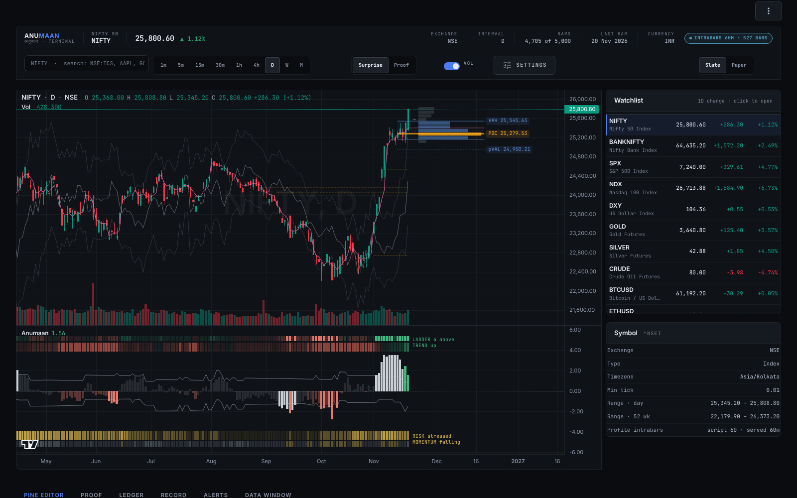

# Anumaan · Terminal

A chart terminal for `anumaan.pine`, laid out the way a trading terminal is. The script runs in it, ported to Python bar
for bar, and is drawn on TradingView's open-source charting library.

```
streamlit run terminal/app.py
```



## What is on the screen

| Area | What it is |
|---|---|
| **Command bar** | The instrument, its last price and change, the exchange, interval, bars calculated (at most 5,000, as `calc_bars_count`), the last bar's time, and where the profile's intrabars came from |
| **Toolbar** | Symbol search (`NSE:TCS`, `AAPL`, `GC=F`, any Yahoo ticker), interval (1m 5m 15m 30m 1h 4h D W M), the Anumaan pane (Surprise or Proof), volume, **Settings**, and Slate / Paper |
| **Chart** | Candles and volume, the volume profile with its value area, POC, VWAP, Initial Balance, prior-session and naked-POC levels and their tags, the landing band, midline, stop history, proven-state marks, the forward cone with its stops, and the table. Below it, the Anumaan pane: the surprise columns against the landing band, and the four tapes with their labels. The status lines follow the crosshair |
| **Watchlist** | Click a row to open it |
| **Symbol** | Exchange, type, timezone, min tick, the day's and 52-week range, and where the profile's intrabars came from |
| **Bottom panel** | **Pine Editor** (the script, read only) · **Proof** (the strategy report: exposure against buy and hold) · **Ledger** (the nine states) · **Record** (calibration per rung, per risk regime, per trend state) · **Alerts** (every alert condition as it fired) · **Data Window** |

**Settings** reads its inputs from `anumaan.pine` itself: the same labels, defaults, options, limits, groups and tooltips, all 45 of
them. The **Display** group's **Theme** behaves as in the script: on Auto it follows the terminal's appearance.

## How faithful it is

**The engine** (`engine/anumaan.py`) ports sections 1 to 6b of the script in its own order, with Pine's semantics where they decide
a value: `ta.ema` seeded on the first value, `ta.rma` seeded on an SMA, `ta.percentrank` returning na if its window holds one,
`ta.sma` skipping na, comparisons with na false. On six instruments it matches the research reference (`research/anumaan.py`) to
floating-point error on every series. The one exception is the cone widths, which differ by 3e-9. The script starts them from
Acklam's inverse normal, and the port follows the script.

**The volume profile** (`engine/profile.py`) ports section 7: sessions, ATR rows frozen at the session's first bar, the intrabar
spread, POC, value-area walk, prior session, naked POCs, VWAP, Initial Balance, row aggregation, HVN / LVN, and tag collision.

**The table and the tapes' words** (`engine/table.py`) use the script's own text and number formats.

What cannot be identical is the **data**. TradingView's feed is not Yahoo's:

- **Intraday history.** Yahoo serves 1m bars for 7 days, 2m to 30m for 60 days and 1h for 730 days. Daily and longer go back as
  far as Yahoo has them. The script runs on the last 5,000 bars either way.
- **Intrabar timeframes.** The script asks for about sixteen intrabars per chart bar. Where Yahoo has no such interval the terminal
  uses the nearest finer one: 2m for the script's 3, and 5m for its 10. It builds 2h and 4h by resampling 1h. Bars older than the
  intrabar history are spread over their range, as the script does where intrabar data does not reach.
- **Volume.** Yahoo reports no intraday volume for some symbols (indices) whose daily bars carry it. There, the profile shares each
  bar's own volume evenly over its intrabars, and the page says so.
- **Sessions.** A session is the exchange's calendar day on intraday charts, the week on daily, and the month above. Futures
  sessions that open the evening before (CME's 6pm) therefore split where the calendar does, not where the exchange does.
- **Min tick** is Yahoo's price hint.

The port has not been compared bar for bar against TradingView's own output: no Pine runtime is available here. On any chart, the
table's eight rows and the Data Window can be checked against the script's table and data window in TradingView.

## Built on

- **Design system.** It comes from Tattva and is shared with Pragyam and Arthagati: `ui/theme.css` is Tattva's, unchanged apart
  from its header. It uses the Graphite and Paper tokens, Inter and JetBrains Mono, and Streamlit pinned to exactly 1.52.2 (see
  `requirements.txt`).
- **Charts.** [TradingView Lightweight Charts™](https://www.tradingview.com/) 5.2.1, Apache-2.0, vendored in `ui/static` with its
  licence and notice. The chart shows the library's attribution logo. Anumaan's drawings that the library has no series for, such
  as profile rows, level lines and tags, the cone and the tapes' labels, are custom primitives positioned in bar indices and
  prices, as the script positions them.
- **Data.** Yahoo Finance via `yfinance`, delayed.
- **Watchlist.** A two-way Streamlit component in plain JavaScript (`ui/static/watchlist`), with no build step.

The terminal is laid out like a trading terminal but carries none of TradingView's branding: its name, logo and trademarks are
TradingView's own. The chart library's attribution is the one exception, and its licence requires it.

## Files

| File | What it is |
|---|---|
| `app.py` | The page: command bar, toolbar, chart and rail, bottom panel |
| `engine/anumaan.py` | The script's engine, sections 1 to 6b, and its alerts |
| `engine/profile.py` | Section 7, the volume profile |
| `engine/table.py` | Section 9, the table, and the tapes' words |
| `engine/palette.py` | The script's palette and transparency ladder |
| `engine/data.py` | Timeframes, symbols, Yahoo bars and intrabars |
| `ui/chart.py`, `ui/static/chart.js` | The chart payload and its renderer |
| `ui/inputs.py` | The settings, read from `anumaan.pine` |
| `ui/panels.py` | The bottom panel |
| `ui/theme.css`, `ui/theme.py`, `ui/terminal.css`, `ui/components.py` | The design system and the terminal's layout |

To deploy on Streamlit Community Cloud, set the main file to `terminal/app.py`. Its `requirements.txt` sits beside it, and the
theme config is in `.streamlit/` at the repository root.
